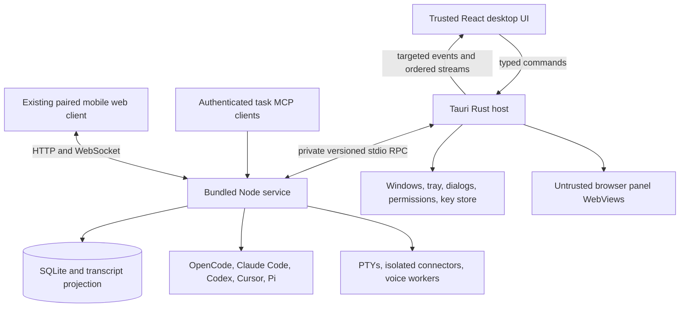

# Tauri migration architecture and contracts

Status: proposed; implementation starts with the gates in [the migration plan](README.md). New paths and interfaces below are design targets, not existing files or APIs.

## Process ownership

Keep the React/Vite UI in a Tauri WebView. Rust owns the native application lifecycle and supervises one bundled Node service. Node retains TypeScript domain services and their existing SDK dependencies. This is a repository-specific recommendation; the prototypes must establish that it can be packaged and operated reliably.



Remote browser panels receive no application capabilities. Browser actions travel from the authorized task service to a restricted host browser adapter, never through an unrestricted remote-page bridge.

Tauri supports bundled external executables through `bundle.externalBin`, with binaries prepared for each target triple. Rust can launch and communicate with these executables. This supports the proposed Node service boundary, but does not by itself package JavaScript dependencies, native addons, or worker scripts. [Tauri external binaries](https://v2.tauri.app/develop/sidecar/).

## Proposed source boundaries

| Boundary | Proposed location | Responsibilities |
| --- | --- | --- |
| Native host | `src-tauri/` | Application identity, WebViews/windows, native commands, sidecar supervision, resources, capabilities, updates |
| Service entry | `src/service/index.ts` | Initialize domain services from injected configuration; signal readiness; own ordered shutdown |
| Desktop contract | `src/shared/desktop-api.ts` | Operation names, request/result types, event payloads, compatibility version |
| Host contract | `src/shared/host-services.ts` | Typed service-to-host operations, resource paths, runtime executable, native status/errors |
| Service transport | `src/service/transport/` | Framing, correlation, validation, queue limits, lifecycle, dispatch |
| Renderer transport | `src/renderer/src/lib/desktop-bridge/` | Electron adapter during migration; Tauri adapter; readiness, invoke, subscriptions, byte encoding |
| Existing domain code | `src/main/` initially | Incrementally remove direct Electron imports; move files only when needed for a clear boundary |

Avoid a repository-wide file move at the same time as behavioral porting. Electron-specific code can remain in an explicitly identified compatibility host until T15. The packaged Node dependency graph must have no runtime Electron imports.

## Desktop bridge

Inventory every `ipcRenderer.invoke/send/on`, `ipcMain.handle/on`, preload method, and direct `window.electronAPI` consumer. Include dynamic and computed event names; a literal-string scan is a starting point, not proof of completeness. Reconcile the inventory with renderer declarations, domain handlers, and mobile/task routes without changing those routes' contracts.

Preserve the renderer-facing APIs in `ipc-client.ts` where possible and introduce a host-neutral bridge beneath them. Direct consumers use the same bridge. A temporary Electron adapter permits incremental verification; final UI code must not require a global named `electronAPI`.

The contract must record the following for each operation:

| Field | Required meaning |
| --- | --- |
| Operation and owner | Stable name; Node domain handler or Rust native handler; owning workstream |
| Input/result | Runtime validation plus TypeScript types; null/missing semantics and serialized error shape |
| Permission | Trusted caller, project/task context, path scope, and any HITL behavior |
| Lifetime | Cancellation, timeout, retry/idempotency policy, and subscription teardown |
| Events | Destination, order, payload encoding, persistence/recovery source, and overflow behavior |
| Compatibility | Existing preload mapping, version introduced, deprecation/removal point |

An illustrative bridge shape is:

```typescript
interface DesktopBridge {
  ready(): Promise<{ protocolVersion: number; engineEpoch: string }>
  invoke<K extends keyof DesktopCommands>(
    operation: K,
    request: DesktopCommands[K]['request']
  ): Promise<DesktopCommands[K]['response']>
  subscribe<K extends keyof DesktopEvents>(
    event: K,
    handler: (payload: DesktopEvents[K]) => void
  ): Promise<() => void>
}
```

`DesktopCommands` and `DesktopEvents` are proposed maps generated or maintained from the inventory. Existing synchronous subscription cleanup wrappers must handle async Tauri listener registration: a component that unmounts before registration finishes must still remove the listener. Renderer startup waits for subscriptions and service readiness before reading initial state.

Tauri provides async commands and channels; its general event system is intended for relatively small messages. Use targeted events for notifications and ordered channels for high-volume terminal, transcript, and audio traffic. This is a design choice informed by Tauri's streaming guidance. [Commands](https://v2.tauri.app/develop/calling-rust/), [events and channels](https://v2.tauri.app/develop/calling-frontend/).

Keep business event payloads compatible where feasible (`task:updated`, `agent:status`, `transcript:changed`, queue, voice, and project events). Transport envelopes may change. Do not use global native broadcasts for transcript contents or audio.

## Rust to Node protocol

Use private stdin/stdout between the supervising host and its child, separate from the existing HTTP task API. Both peers may issue requests because Node also needs native services. Scope direction and operation names explicitly; do not turn this into a general shell/file/eval dispatcher.

Specify a versioned RPC envelope with `kind`, unique `requestId`, `operation`, and validated `payload`; responses carry either a result or a stable error code with a redacted message. Events additionally carry an engine epoch and a stream sequence where needed. Bootstrap exchanges protocol version, configured profile/resource roots, bundled Node executable, build identity, and native capabilities.

T04 must freeze framing and limits. The proposed default is newline-delimited JSON with base64-encoded bytes; prototype bounded frame sizes and chunk large snapshots/audio before accepting it. Never put ordinary `console.log` output on the protocol's stdout. Redirect service/dependency logs to stderr or a redacted log sink before domain modules are imported.

Required transport behavior:

- Partial reads and multiple frames per read are supported. Unknown operations, invalid versions, malformed frames, oversized input, and invalid arguments fail explicitly.
- Request IDs are disjoint by direction. Timeouts and cancellation release request state; stale responses from a previous engine epoch are ignored.
- Queue sizes, maximum frames, chunk sizes, and stall deadlines are documented and enforced. Durable transcript overload triggers snapshot/delta recovery; terminal/audio overload has an explicit bounded policy and cannot silently corrupt a stream.
- A blocked request cannot prevent processing its native-service callbacks. Avoid synchronous host callbacks from SQLite row serializers, which would deadlock or force a broad API change.
- Crash/disconnect rejects pending operations and reports an unavailable state. Never blindly replay task starts, source writes, approvals, or other mutations; use operation-specific idempotency and persisted state.

For transcript bind/rebind, register the listener and buffer incoming deltas, read the durable snapshot and revision cursor, apply buffered revisions idempotently, then request deltas after that cursor. Use existing stable part IDs and projection semantics. If continuity is uncertain or `reloadRequired` is set, obtain a fresh snapshot. Channel delivery alone does not establish persistence or recovery.

## Host services and lifecycle

Replace `BrowserWindow` references and `guardedIpcSend` calls in domain services with an event sink and explicit native interfaces. Keep UI events optional when no window is visible. Maintain mobile events as their own destinations.

| Current Electron service | Target responsibility |
| --- | --- |
| `app.getPath/getAppPath`, `process.resourcesPath`, `isPackaged` | Injected compatible profile paths, read-only resource root, runtime executable, build mode |
| `BrowserWindow`, `Tray`, `Menu`, app events | Rust window state, close/tray/quit behavior, menus, reopen, update restart |
| `ipcMain/ipcRenderer/contextBridge` | Typed commands, targeted events/channels, validated stdio dispatch |
| `dialog`, `shell`, clipboard/native image | Scoped Rust/native adapters preserving file selection, reveal/open, image and file-copy semantics |
| `protocol.handle('app-attachment', ...)` | Scoped attachment/resource serving; support media and previews without exposing an arbitrary file root |
| `safeStorage` | Versioned credential provider and legacy import; see data section |
| `utilityProcess.fork`, `process.parentPort` | Isolated Node child plus adapted connector host transport and entry |
| `globalShortcut`, `systemPreferences` | Native shortcut and microphone permission adapters with explicit denial/error states |
| `powerSaveBlocker` | Native sleep inhibitor held only while the engine has the corresponding live work |
| `webContents`, session/header hooks | Browser adapter proven in T02; no assumed one-to-one plugin replacement |
| `electron-updater` | Native updater or explicit manual-download flow; framework-transition plan |

Startup order: acquire the cross-host profile lock; resolve identity, resources, and compatible paths; initialize the credential provider; run any guarded import; launch Node; open/migrate its database; initialize domain services and authenticated APIs; announce readiness; attach the UI and hydrate. Deliver a cold-start OAuth callback only when the owning service is ready; validate callback scheme/path/state and consume it once.

Close, hide, reload, and quit are distinct operations. Reopening a UI attaches to the existing service. Schedulers are started once per engine lifetime, not once per new window. Explicit quit/update stops admissions and schedulers, drains or aborts sessions and connector calls, stops voice, APIs, tunnels and owned children, checkpoints/closes SQLite, then exits. Port the intent of `shutdownAppServices`, including any scheduler cleanup omitted from today's shutdown path.

On service crash, show recovery status, reject outstanding requests, and obtain a fresh engine epoch after a bounded restart. Reconcile persisted task/session state before restarting work; do not resume active agent mutations automatically without a defined recovery policy. Host death must terminate owned children through a platform-tested parent-death strategy (including Windows process trees) and next-start cleanup. Never kill unrelated processes by executable name.

## Data and secret compatibility

Node remains the only SQLite owner. Preserve schema migrations, foreign keys, WAL, busy timeout, transcript upserts, and existing seed behavior. Use a consistent SQLite backup or a fully stopped/checkpointed profile for rehearsal; copying only an active `.db` may lose WAL data.

Resolve the current Electron profile explicitly on each OS. Preserve `21x.db`, attachments, workspaces/repositories, plugins, voice assets, and settings. Test the existing 20x identity import. Worktree metadata and stored absolute paths make a new default data directory a behavioral change, so the recommended cutover reuses the compatible profile path under an exclusive lock. Development and parity tests use separate roots.

Legacy secret data includes secret BLOBs, OAuth access/refresh token BLOBs, provider key settings with `safeStorage:v1:` prefixes, connector credential BLOBs, and credential-bearing agent/MCP/source configurations. Inventory actual storage formats before changing serializers. Current secret/settings serializers permit plaintext fallback, while persistent connector credentials require encryption availability; document these different policies instead of assuming they are equivalent.

Electron `safeStorage` uses platform-specific storage; Linux can fall back to `basic_text`. Treat decryption and security availability as separate migration cases. An OS credential store or Tauri storage plugin does not establish legacy ciphertext compatibility. [Electron safeStorage](https://www.electronjs.org/docs/latest/api/safe-storage).

T03 must prove a supported import path. The preferred candidate is a transitional Electron build, running under the existing identity and OS account, which reads legacy values and hands them to the new provider through an authenticated private channel. No plaintext export files, argv values, or renderer access. Import on a consistent backup, verify every credential class, commit atomically, and retain the original encrypted backup and import journal. An unavailable keychain or unreadable ciphertext blocks conversion with actionable recovery; it must not become an empty credential or a success marker. Explicit reconnection is a proposed fallback requiring a product decision.

The new provider must resolve the synchronous serializer constraint. Evaluate an OS-store-protected application key loaded during trusted bootstrap, with versioned authenticated encryption in Node, versus converting database APIs to async native calls. Freeze that choice at G1; do not insert hidden synchronous RPC into database serialization. Any retained key/plaintext cache is limited to the service process, never inherited by worker children, and cleared on shutdown as far as practical. New persistent writes must not silently fall back to plaintext.

Once credentials are converted, old Electron builds cannot be assumed to read them. Rollback must restore the matching pre-cutover profile or use a tested reverse conversion; [the rollout procedure](validation.md#cutover-and-rollback) distinguishes rollback before and after live writes.

## Native dependencies, workers, and integrations

Pin and bundle a standalone Node runtime for each release target. Rebuild/package `better-sqlite3`, `node-pty`, and optional voice native dependencies for that Node ABI and OS/architecture, using their documented compatibility rather than Electron's ABI. Verify packaged execution on machines without system Node. Node remains a development requirement; end users should not gain an implicit system-Node requirement for built-in features.

Package task-management MCP, connector host, voice recognition and TTS worker entries as real files with their required dependencies. `externalBin` covers executable bundling; resource discovery and fork/module resolution still require explicit implementation. Replace `ELECTRON_RUN_AS_NODE`, ASAR paths, runtime selection in `node-worker-runtime.ts`, and seeded MCP command assumptions. A seed upgrade may update app-managed entries, but must preserve user-managed MCP configuration.

Adapt both sides of the connector host: `utility-transport.ts` and `host-entry.ts` currently use Electron-specific messaging. Preserve the existing `PieceHostTransport` contract, minimal environment, call-scoped credentials/KV access, timeout, crash restart, SSRF controls, package allowlist, and redaction. A child process is process isolation, not a claim of an OS filesystem/network sandbox.

Agent CLI discovery, shell environment loading, secret-shell wrapping, Git provider sessions, local/remote MCP and OAuth, tunnels, chat, and Commander all run against the new runtime paths. Preserve voice turn epochs, cancellation, install/remove state, optional recognition runtime, system TTS availability, and suppression of speech audio to mobile. PCM and speech chunks need an explicit byte format tested across Rust/JSON/JS boundaries.

## Browser and WebView feasibility

The current broker explicitly uses `loadURL`, `executeJavaScript`, and `capturePage` on registered panel WebContents; it is not a global CDP integration. Recordings additionally use isolated-world scripts and browser event hooks. Tauri uses WebView2 on Windows and WebKit on macOS/Linux, so Chromium-only behavior and Electron `<webview>` methods need platform evidence. [Tauri WebView versions](https://v2.tauri.app/reference/webview-versions/).

T02 must demonstrate browser-panel placement/clipping in the canvas, focus/resize/zoom, persistence and cookie isolation, navigation/popups/downloads, task-linked registration, DOM snapshot/actions, script results, screenshot capture, console/network visibility, and recording start/stop/cleanup. Characterize current header/frame handling and decide which behavior can be carried over safely. An iframe or external browser link alone does not satisfy the current broker contract.

Native child WebViews may require per-platform extensions. If the prototype cannot prove parity, record the failure and alternatives with product implications: a scoped browser helper adds packaging cost; a reduced browser feature set changes scope. Do not continue full implementation on the assumption that an unspecified plugin will solve it.

## Security boundary

Define explicit capabilities for the trusted desktop WebView, with no remote URL grants or broad wildcard window access. Register custom command permissions and validate caller identity and arguments server-side. Tauri's documentation states that app commands registered through `invoke_handler` are otherwise available to app windows/WebViews by default; capability files alone are not evidence that a custom dispatcher is restricted. [Tauri capabilities](https://v2.tauri.app/security/capabilities/).

Task/project authorization and path checks remain domain responsibilities. Canonicalize paths, reject traversal and symlink escapes where applicable, validate external URLs, and restrict attachment resource access. Preserve artifact sandboxing and main-window navigation guards. Review CSP, remote navigation, download handling, origin checks, and native command exposure on the actual packaged host.

The Rust/Node channel is private to the supervised child; existing local APIs retain independent authentication. Native event delivery must explicitly target trusted destinations because event access is not a substitute for command authorization. Test malicious remote panels and artifact frames against every privileged command family.

## Build and update boundaries

Introduce a standalone Vite desktop build and service bundle alongside the existing mobile build. Remove Electron-specific tsconfig/toolkit dependencies only after host-neutral equivalents exist. Rust/plugin versions and lockfiles are pinned at G1. Release CI packages resource manifests and target-specific Node/native dependencies; connector allowlist, audit, provenance, and production-bundle checks continue to gate releases.

Preserve `com.krazyjakee.21x` identity and the registered schemes from `app-identity.ts` for cutover, with experimental builds isolated to avoid stealing production OAuth callbacks. Keep the legacy scheme's existing compatibility window; changing it is a separate decision.

Tauri updater artifacts require cryptographic signatures and its own metadata. Those signatures are separate from Apple/Windows distribution signing. Choose managed update signing or a clear manual update flow; retain manual release triggers unless separately changed. The first Electron-to-Tauri install may require a bridge release or manual installer and must be rehearsed separately from Tauri-to-Tauri updates. [Tauri updater](https://v2.tauri.app/plugin/updater/).
