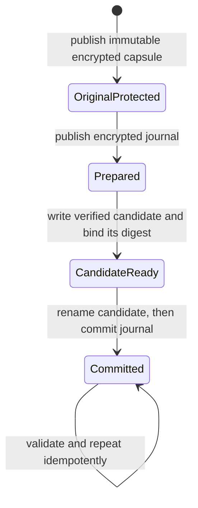

# SQLite credential import rehearsal

[profile-migration-rehearsal.ts](../../src/main/platform/profile-migration-rehearsal.ts)
provides a bounded T10 rehearsal for an explicitly created synthetic or copied
fixture. It never discovers a user profile, replaces its source database,
activates a candidate, or registers a shipping credential provider. #193 retains
installed-profile migration, signed macOS ACL access and live cutover gates.

`createProfileMigrationFixture()` creates only a marked directory directly under
canonical OS temp, named `21x-migration-rehearsal-*`. Trusted fixture preparation
must create/copy `21x.db` there and stop its producers. The importer requires the
exact canonical directory through a held [ProfileLock](profile-lock.md), a
versioned fixture marker, explicit trusted interpretation for every credential
BLOB, and trusted legacy/destination providers. The destination must attest to
OS protection and complete bootstrap before use. That assertion is not proof of
an actual OS store; [retained T03 evidence](credential-proof-evidence.json) supplies
the separate real platform proof.

## Consistent original and encrypted backup

The importer checks a stopped WAL with `wal_checkpoint(TRUNCATE)`, rejects a busy
checkpoint or mode change, switches the fixture to DELETE mode, and holds a real
`BEGIN EXCLUSIVE` transaction on the source through publication. This blocks
another SQLite transaction even when an uncooperative connection ignores the
separate profile sentinel. Source file identity, absence of WAL/SHM, integrity,
foreign keys and declared resources are checked. Checkpoint/mode normalization
can change physical database headers; credential representations and logical rows
remain original. A generic callback cannot assert that a production profile is
stopped, and no such callback is accepted.

SQLite `serialize()` copies the consistent stopped image into bounded RAM. The
initial default maximum is **8 MiB**, reducible by callers. No plaintext snapshot
or decrypted-credential file is written. The entire original SQLite image is
wrapped by the injected authenticated destination provider before persistence.
Each encrypted chunk represents at most 512 KiB of original bytes, respecting the
candidate provider's 1 MiB string limit. An encrypted manifest binds fixture and
snapshot identities, total size, digest, format and chunk count; encrypted chunk
labels bind index/order/count to that snapshot. Reorder, truncation, substitution,
wrong keys, overflow and corruption fail closed. This is a framing protocol using
the existing standard authenticated cipher, not another encryption algorithm.

The immutable `original.sqlite.enc` is published from an encrypted pending file,
fsynced, and made read-only. It is never overwritten or deleted by the importer,
including recovery and rollback. The native application key must remain available
for the rollback retention period. Buffers are cleared when possible; JavaScript
strings/provider internals cannot be completely wiped.

## Candidate and recovery states

All current credential-bearing rows in the four audited locations are enumerated:
`secrets.value`, nonempty `*_api_key` settings, non-null OAuth access/refresh BLOBs,
and non-null connector auth paired with `auth_type`. Every BLOB needs explicit
provenance, and missing/duplicate/extra interpretations fail. Known unsupported
agent API-key JSON and nonempty MCP headers/environment or connector config are
rejected. This is not a general JSON credential sweep or proof that arbitrary
historical/user configuration contains no undiscovered secrets.

The existing immutable credential planner decrypts only in trusted memory and
verifies the destination roundtrip. A reconstructed in-memory SQLite database
applies exact row/key updates in one transaction. Candidate settings use the
experimental `21x-credential:<destination-format>:<ciphertext-base64>` wrapper;
this does not change shipping Electron settings. Other credential columns contain
the provider's versioned binary ciphertext.

`secure_delete=ON` and in-memory `VACUUM` remove original plaintext-fallback values
from freed cells/pages before first candidate persistence. Normalization must
preserve schema, application/user versions, logical IDs, hidden row IDs and every
noncredential value; otherwise the rehearsal fails. Profiles whose implicit row
identities change during normalization are unsupported, rather than silently
renumbered. SQLite's [VACUUM row-ID semantics](https://sqlite.org/lang_vacuum.html)
and [secure-delete limitations](https://sqlite.org/pragma.html#pragma_secure_delete)
still require installed historical-profile rehearsal, particularly FTS/history.

Only a fully converted candidate with encrypted credential fields and ordinary
profile metadata reaches `candidate.sqlite.pending`. The journal is itself
authenticated/encrypted and binds original/candidate digests and the preservation
fingerprint. File publication uses fsync and rename under the held lock:



Recovery reads authenticated state and actual files. Prepared state can discard
only its owned uncommitted pending candidate and regenerate it. Ready state accepts
exactly one matching pending/final candidate and completes publication. Committed
state verifies the final candidate without re-encrypting it. Missing/extra files,
modified originals/resources, corrupt journals or mismatched identities/digests
fail closed. Original source rows are never updated. Directory fsync is used where
Node supports it; Windows directory power-loss durability is not established by
these process-crash checks and remains an installed-platform gate.

## Resources and rollback boundaries

Resources are **retained and verified byte-for-byte**, not archived in the SQLite
capsule. The caller explicitly lists at most 256 relative fixture files, with a
separate bounded total byte limit; symlinks, hardlinks and external/traversal paths
are rejected. Hashes and identities stay in encrypted state and fixed errors omit
values/paths. Unlisted resources, workspace trees and arbitrary external project
paths are not backed up. This is not an immutable backup of an entire profile.

Explicit rollback authenticates the immutable original, validates original
representations, and writes only `rollback-original.sqlite` inside the same owned
rehearsal directory. It never replaces `21x.db` or the committed candidate.
Rollback refuses any legacy plaintext credential representation rather than
persist it again; those originals remain available only inside the encrypted
capsule/in memory. Resource verification and repeated rollback are idempotent.
Rollback application to a live installation is a separate gate.

## Central batch validation

```sh
node node_modules/vitest/vitest.mjs run --project main --maxWorkers=1 src/main/platform/profile-migration-rehearsal.test.ts
```

Tests use the actual production SQLite schema and actual authenticated cipher with
synthetic unit keys. They cover full row/resource/integrity preservation, stopped
WAL, SQLite contention, all durable interruption boundaries, a real child-owner
crash after the ready-journal rename, repeat/recovery, multi-chunk binding,
corruption, unsupported coverage, plaintext-remnant removal and rollback refusal.
Unit keys do not attest to native OS protection. An actual fixture import using
T03's private real Electron exporter/native bootstrap, platform filesystem
rehearsal, full resource archival, power-loss failure injection and signed/live
profile migration remain necessary release integration evidence.

See the primary [SQLite serialization API](https://sqlite.org/c3ref/serialize.html),
[checkpoint contract](https://sqlite.org/pragma.html#pragma_wal_checkpoint), and
[better-sqlite3 serialize/deserialize API](https://github.com/WiseLibs/better-sqlite3/blob/master/docs/api.md).
