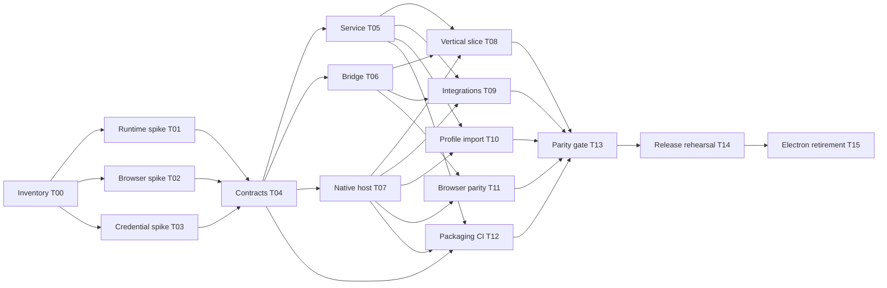

# Migration agent workstreams and task cards

Use this with the [plan](README.md), [architecture](architecture.md), and [validation gates](validation.md). Agent labels describe implementation roles, independent of which coding backend supplies them. The app's per-project Captain and a migration integration coordinator are different responsibilities.

## Team and file ownership

One coordinator maintains the integration branch and shared contracts. Parallel agents own bounded feature branches in separate worktrees. Assign a role only when its prerequisite task is complete; the coordinator can batch roles if fewer agents are available.

| Role | Owns | Delivers | Boundary with other roles |
| --- | --- | --- | --- |
| Coordinator | Migration docs, decision register, final assembly in `src/main/index.ts`, interface review and merge queue | Inventory, contract acceptance, integrated gates, retirement audit | Shared-file changes require coordination; every feature gets a distinct task owner |
| Runtime | Proposed `src/service/`, native host lifecycle/supervision modules, `node-worker-runtime.ts`, resource manifest design | Bundled Node service, bootstrap, shutdown/crash recovery, native ABI proof | Native host modules are separate from browser/security/update modules; release owns packaging configuration |
| Bridge | Proposed shared desktop/host types, service dispatcher, Electron compatibility adapter, event sinks, `src/main/ipc/` domain extraction | Versioned transport and complete command/event mappings | Native IPC logic is handed to feature owners; freeze types before dependent feature edits |
| Renderer | `src/renderer/`, desktop Vite configuration | Bridge adoption, listener lifetimes, UI readiness/recovery, WebView layout parity | Browser agent owns browser panel components; feature tests agreed before editing shared stores |
| Data | `src/main/database*`, serializers, credentials, compatible paths/identity import, native credential module | Safe profile/secret transition, one-writer lock, backup/recovery | Schema edits are serialized; native secret interfaces reviewed with runtime/bridge |
| Integrations | Adapters and agent-manager helpers, connectors, OAuth, CLI/MCP, PTYs, voice, mobile/task APIs | Worker and integration parity under standalone Node | Bridge owns handler registration/extraction; existing terminal/voice handler logic stays with this role |
| Browser | Browser panel UI, broker, hardening, recording, native browser modules | Cross-platform embedding and task-linked automation/recording | Shares resource/path contracts with data; cannot grant remote pages application capabilities |
| Release | `package.json`, lockfiles, CI, packaging/release scripts, `src-tauri` manifests and native updater module | Reproducible target artifacts, installer transition, update policy | Single lockfile/config writer; runtime supplies resource/runtime requirements |
| Verification | Test harness/setup, new contract/parity tests, evidence reports | Cross-platform regression, load, security, upgrade and recovery evidence | Test changes that move existing feature files are coordinated with their owners |

Large areas such as integrations can be split into smaller cards after G1. Do not give two agents simultaneous ownership of the same handler, store, manifest, or entry point. Each agent proposes edits to shared files as a small separate commit or patch for the listed owner.

## Coordination protocol

1. Start a migration integration branch from a recorded revision. Create one worktree/branch per task from the latest accepted integration head. Use isolated synthetic/copied profile roots; never test on the live user profile.
2. Read the architecture contracts and relevant existing behavior docs. Recheck current sources, because inventory counts and schema versions change.
3. Declare owned paths and requested shared-file edits before implementation. The coordinator records collisions and dependency changes.
4. Keep public contracts backward-compatible through G3. Interface changes include types, serialization, fixtures, both callers, and compatibility behavior in the same reviewed change.
5. Submit small reviewable PRs. Merge foundation contracts first, then service/native adapters, then dependent features. Rebase dependent work when a shared contract changes.
6. Provide executable tests or packaged evidence appropriate to the change. A mocked Electron API does not prove a Tauri native feature works.
7. Report blockers with a minimal reproduction, affected gate, and options. An agent does not redefine product scope or mark a missing feature complete.

The coordinator integrates feature commits, resolves entry-point wiring, and reruns the affected gates. During G0, runtime, browser, and credential prototypes can proceed in parallel once T00 has identified their shared identity/profile assumptions. During implementation, use the dependency graph below; broad parallel edits start after T04.

## Dependency graph



T12's build skeleton may start at T04; its packaged completion depends on T05/T07. Verification builds harnesses and fixtures early, then owns T13 after all feature paths land. T08 uses a fixture profile; production credential conversion belongs to T10.

## Task cards

### T00 — Establish baseline and complete inventory

Owner: coordinator + verification. Dependencies: none.

Inventory desktop commands/events/direct API consumers, Electron imports, native modules, resources, worker entry points, persisted credential formats, profile paths, process ownership, and CI targets. Capture actual per-platform close/tray/reopen behavior. Include chat, Commander, artifacts/canvas/drawing, connector credentials, and seeded MCP entries. Record current schema/version and runtime memory/startup/install-size measurements under reproducible scenarios.

Deliver: checked-in inventory and parity checklist linked from the decision register, with each operation/resource assigned to an owner. Done when every known exposed desktop operation has an owner, destination, permission, and validation scenario; unresolved behavior is explicit.

### T01 — Prove packaged standalone Node runtime

Owner: runtime + release. Dependencies: T00.

Build a minimal Tauri host that launches a pinned bundled Node with a private round-trip protocol. In packaged builds, load `better-sqlite3`, create a PTY, fork a real-file worker, and load representative agent SDK dependencies. Prove native ABI/resource resolution and cleanup on each OS/architecture; system Node must be absent from PATH for the built-in-runtime test. Record redistribution/dependency and CI requirements.

Deliver: prototype, resource manifest, measured packaged results, and D1 recommendation. Done when all four target builds run or an explicit failed feasibility report blocks G0. Development-only launch is insufficient.

### T02 — Prove browser replacement

Owner: browser. Dependencies: T00.

Prototype the browser surface described in [architecture.md](architecture.md#browser-and-webview-feasibility): canvas placement, task-linked registry, DOM action/result, screenshot, cookie isolation, console/network observability, and recording hooks. Test representative sites and malicious navigation/IPC probes on WebView2 and both WebKit platforms. Compare with the existing Electron broker rather than assuming a CDP dependency.

Deliver: platform capability matrix, prototype evidence, supported adapter proposal, and unresolved costs/limitations. Done when required behavior is demonstrated or the coordinator records a blocking scope/architecture decision. An iframe-only demonstration is incomplete.

### T03 — Prove legacy credential and profile compatibility

Owner: data. Dependencies: T00.

Create fixtures under a real Electron process and prove import into the candidate credential store on each OS. Cover secret BLOBs, OAuth refresh/access tokens, prefixed settings, connector credentials, legacy plaintext, locked/unavailable stores, and corruption. Verify app identity/profile resolution and transactional failure recovery. Prototype the transitional exporter and decide how synchronous serializers interact with native storage.

Deliver: format inventory, fixture generator, private import prototype, D3/D4 recommendation, rollback limits. Done when values remain usable and unavailable/corrupt cases fail safely without plaintext export or silent loss. Mock `safeStorage` fixtures cannot close this task.

### T04 — Freeze shared interfaces and permissions

Owner: bridge; coordinator accepts. Dependencies: T00–T03.

Define desktop command/event maps, host-services interface, stdio framing/bootstrap/versioning/errors, byte encoding, queue/frame limits, cancellation, retry policy, and listener lifecycle. Define custom native command permissions and trusted destinations. Assign handler ownership and specify native-to-service callbacks without synchronous deadlocks.

Deliver: shared contract types, reviewed permission/operation inventory, contract fixtures, D2/D7/D8 decisions. Done when runtime, data, renderer, integrations, and browser owners can implement against stable interfaces and G1 is accepted.

### T05 — Extract service lifecycle and supervise it

Owner: runtime. Dependencies: T04.

Extract startup/shutdown from `src/main/index.ts` through owner-reviewed wiring. Inject host paths/events/native services, initialize domain services once, and announce readiness after database/APIs are ready. Implement profile lock, parent-death handling, engine epochs, bounded restarts, process-tree ownership, and ordered shutdown. Start schedulers independent of window recreation.

Deliver: service entry, supervisor, deterministic lifecycle fixture and packaged crash/quit evidence. Done when reload/reopen does not duplicate sessions or schedulers, SQLite closes cleanly, and owned processes terminate without killing unrelated work. Runtime lock coordination with old Electron is required before shared-profile cutover.

### T06 — Replace IPC transport and domain event delivery

Owner: bridge. Dependencies: T04.

Separate domain handlers from Electron registration and map the full inventory onto typed dispatch. Replace BrowserWindow-bound event sends with sinks. Implement trusted destination routing, validation, ordered streaming, listener disposal, and transcript snapshot/delta recovery. Keep mobile/task API contracts separate.

Deliver: service dispatch, compatibility adapter, Tauri bridge, contract tests for operations/events and reconnect races. Done when inventory coverage is complete and invalid callers/frames/arguments cannot reach privileged handlers. Feature owners supply native implementations; coordinator resolves shared handler registration.

### T07 — Implement native application services

Owner: runtime, with data/feature owners for their native modules. Dependencies: T04.

Implement window state/chrome, tray, menus, dialogs, clipboard/image/file handling, URL/path opening, compatible resource serving, permission prompts, shortcuts, sleep inhibition, and callback delivery. Supply restricted native command permissions. Browser modules and credential conversion stay with their owning cards.

Deliver: native modules plus packaged per-platform checks. Done when current UX and trusted-caller restrictions match the inventory, attachment URLs cannot escape scope, and cold/warm OAuth callbacks are queued/validated exactly once.

### T08 — Deliver end-to-end renderer vertical slice

Owner: renderer + verification. Dependencies: T05–T07.

Adopt the bridge below `ipc-client.ts`, replace direct preload consumers, and handle readiness/recovery/subscription teardown. Deliver task creation → deterministic agent output → durable transcript → approval → completion → reload. Preserve renderer stores, project filters, and existing business behavior.

Deliver: packaged demonstration and race/reload regression tests. Done when the slice runs on all target OS families with a fixture profile and no dependency on Electron preload globals. G2 records what remains for full feature parity.

### T09 — Port agent integrations, PTYs, isolated workers, and voice

Owner: integrations. Dependencies: T05–T07.

Exercise all five coding backends, approval/questions, queue/admission limits, Captain/triage/heartbeat, credit handoff, worktrees/skills/secrets, CLI discovery/install, local/remote MCP, OAuth/task sources, chat/Commander, mobile pairing/tunnel, and PTYs. Adapt connector transport and host entry together. Package recognition/TTS workers and preserve their install/permission/cancellation behavior and desktop-only audio routing.

Deliver: feature adapters with deterministic tests and installed-backend smoke evidence. Done when [the relevant parity rows](validation.md#feature-parity-matrix) pass under bundled Node and owned workers close cleanly. Split this card into separately owned feature subtasks if needed; all are required for G3.

### T10 — Implement transactional profile and credential transition

Owner: data. Dependencies: T05/T07 and the accepted T03 decision.

Implement consistent backup, import journal/idempotence, compatible paths, complete credential conversion, locked-store errors, old identity import, and rollback safeguards. Preserve migration/seed behavior and user MCP entries. Block conflicting hosts from a shared profile; experimental builds use isolated copies.

Deliver: transitional Electron importer/exporter if required, Tauri import path, fixtures, interrupted/repeated import tests, and operator recovery instructions. Done when copied real encrypted profiles pass on every OS, failure leaves a recoverable original, and post-conversion rollback limitations are explicit.

### T11 — Implement browser panels, automation, and recordings

Owner: browser. Dependencies: T06/T07 and the accepted T02 decision.

Replace panel UI and broker/native hooks using the proven adapter. Preserve exact panel IDs, task-link authorization, no access to main UI, redacted snapshots, screenshots, isolated recordings, and storage/cleanup. Include console/network tooling, browser permissions, canvas layering/focus, and navigation/session lifecycle.

Deliver: native adapters, broker/UI changes, cross-platform parity and isolation evidence. Done when browser agents and recordings work with multiple panels and cross-task access is rejected on every OS. Unsupported features remain blockers, not successful no-ops.

### T12 — Build target artifacts and CI

Owner: release. Dependencies: T04 for skeleton; T05/T07 for completion.

Add desktop Vite, Node resource/native-addon packaging, Rust/Tauri configuration, reproducible per-target build jobs, and service/native/renderer/mobile tests. Replace Electron test runtime/rebuild assumptions incrementally. Preserve connector allowlist/license, audit/provenance, manual release triggers, and resource/production-bundle checks. Decide update signatures versus manual update UI; document OS-signing policy separately.

Deliver: artifacts for macOS x64/arm64, Windows x64 NSIS, Linux x64 AppImage, lockfiles/toolchain pins, and staged release metadata. Done when clean machines can install/run built-in features without system Node and CI retains test/artifact evidence.

### T13 — Close full parity and regression gate

Owner: verification. Dependencies: T08–T12.

Run the complete validation matrix, injection/authorization probes, reconnect/overflow/reload races, native-module checks, background/quit/crash recovery, upgrade fixtures, and performance comparisons. Audit Electron imports in the service graph and legacy preload use in renderer paths.

Deliver: evidence report mapped to each matrix row and platform, with defect severity/owner. Done when there are no unresolved data-loss, authorization, feature-parity, or packaging blockers; performance targets agreed from T00 are met or explicitly reconsidered. G3 requires packaged evidence.

### T14 — Rehearse cutover, updates, and rollback

Owner: release + data + verification; coordinator accepts G4. Dependencies: T13.

Execute [cutover and rollback](validation.md#cutover-and-rollback) from an actual current Electron installation, including credential import, install identity and OAuth registration, rollback before live writes, and post-write recovery. Rehearse a second Tauri version through the selected update mechanism. Verify resource/process closure, signatures where configured, downgrade policy, and uninstall data retention.

Deliver: tested installer/update artifacts, supported release path, recovery runbook, retained baseline and backups. Done when product/release owners can review concrete artifacts and evidence before publishing. Do not publish or change a live release feed as part of this rehearsal.

### T15 — Retire Electron and refresh documentation

Owner: coordinator + release. Dependencies: T14.

Remove compatibility host/preload, Electron packages/updater/toolkit, Electron-only configs/scripts/native rebuild/test launcher, and abandoned shims after the transition path is secured. Update README, AGENTS architecture, Windows setup, signing, voice, connector, browser, and developer test docs to describe the delivered behavior. Historical migration fixtures may remain clearly labeled.

Deliver: final dependency/code/resource audit and maintained host architecture docs. Done when shipping Tauri paths run without Electron, every retained legacy item has a transition/testing purpose, and G5 verification passes. Keep any transitional importer as a separately retained artifact for its documented support period.

## Agent assignment template

Copy this into each implementation task and fill in its card-specific values:

```text
Implement Txx from docs/tauri-migration/workstreams.md.
Objective:
Prerequisites and accepted decision IDs:
Owned paths:
Shared-file edits to request from their owner:
Public contract version and compatibility requirements:
Behavior/parity rows to preserve:
Required tests and packaged-platform evidence:
Deliverables and completion criteria:
Profile isolation and process/resource constraints:
Report unresolved assumptions with reproduction and affected gate.
```

## Handoff and PR record

Every handoff includes task ID, base/head revisions, owned paths, actual behavior delivered, contract changes, dependency/merge order, commands and environments used for validation, evidence links, and remaining defects with owners. Include an example of the trigger and resulting behavior so another agent can verify it without reading the transcript.

The coordinator updates the decision register and gate status from reviewed evidence. “Compiles,” “plugin added,” and “tests pass with mocks” are progress reports, not proof that a packaged native migration feature is complete.
